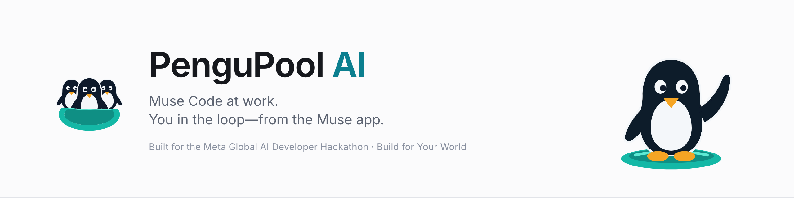
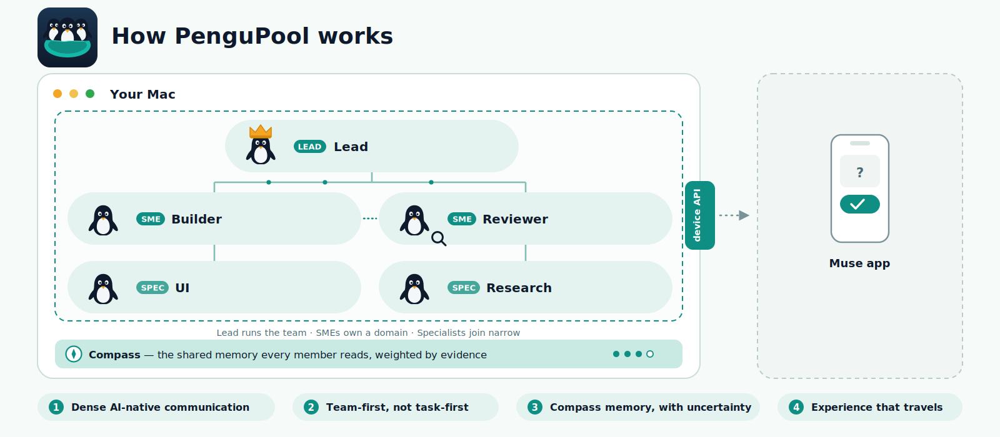
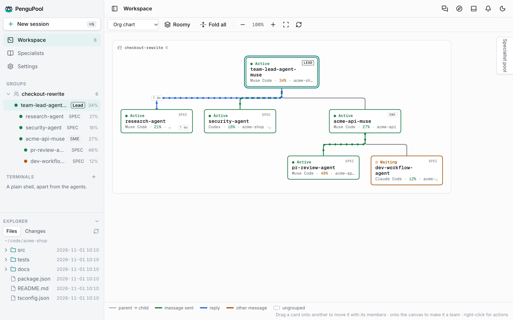
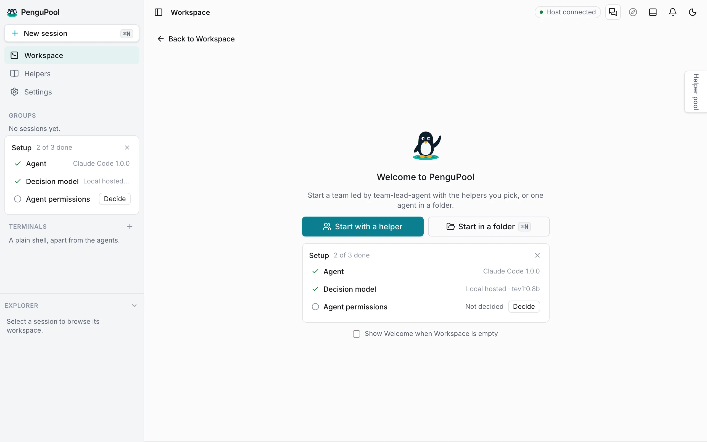
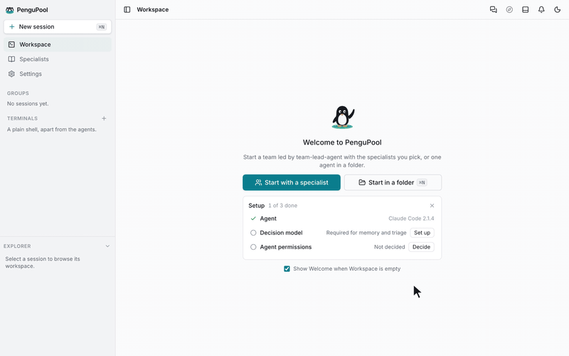
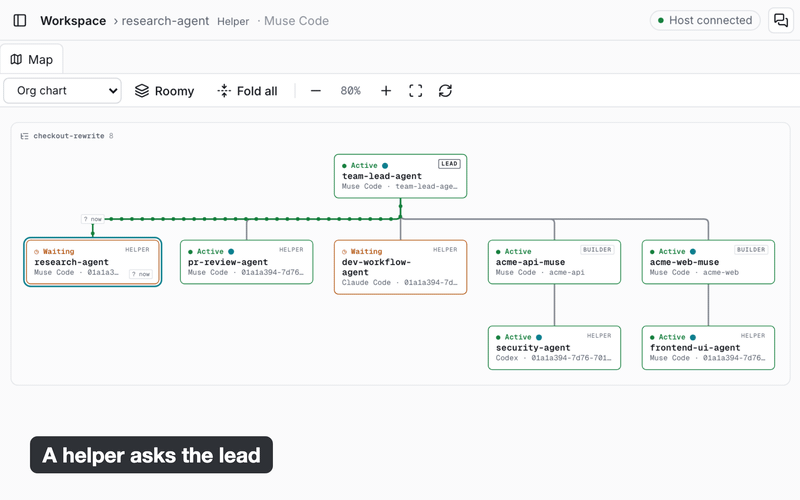

<picture>
  <source media="(prefers-color-scheme: dark)" srcset="assets/screenshots/banner-dark.png">
  
</picture>

PenguPool brings your coding-agent team, your preferences and its waiting questions into one workspace. Run Muse Code on your Mac, follow the team from the Muse app, and send your answer back to the session that needs it.

  <a href="https://github.com/nduwork/pengupool-ai/releases/latest">Download</a> ·
  <a href="#muse-in-the-loop">See the Muse workflow</a> ·
  <a href="docs/getting-started.md">Get started</a> ·
  <a href="docs/phone.md">Muse setup</a>

Built for the Meta Global AI Developer Hackathon · Build for Your World

## Muse in the loop

<picture>
  <source media="(prefers-color-scheme: dark)" srcset="assets/media/muse-loop-dark.png">
  
</picture>

Data flow, not push notifications: the Muse app checks PenguPool for waiting questions.

**On your Mac, Muse Code works with your team's context.** PenguPool's Muse plugin connects session
start, prompts and turn events to the team's context, your Compass and a specialist's own journal. That
lets the coding agent work within the preferences you have already recorded.

**On your phone, Muse brings the question back to you.** A paired Muse device can read the team's
waiting requests, send your instructions and answer supported questions and check-ins. PenguPool returns
your answer to the relevant session through its existing owner-input and answer paths.

**The contribution is the connection:** a coding-agent workspace that keeps the owner's context and
decisions in the loop across the Mac and Muse app. Other supported agents can join the same workspace.

Coding uses the model selected by Muse Code. Memory/check-in triage uses a separately configured System
One model; the local Tev1 default is Together AI's Qwen-based model.
[Model responsibilities](docs/harnesses.md#who-does-what).

## What you can do

- **Run agents side by side.** Claude Code, Codex, Muse Code, pi and OMP, plus Claude Code through
  Ollama, each in its own terminal session. Sessions keep running when the app or its host restarts.
- **Start a team.** Welcome's *Start with a specialist* starts a team led by team-lead-agent with the
  specialists you pick (research, PR review, security, …), or start one agent in a folder and grow a
  team around it on the map.
- **Say it once.** Tell any session how you want things ("small commits", "never touch the migrations
  folder"). It becomes a line in your **Compass**, and every agent gets your Compass in its context.
  Each specialist also keeps a private **journal** of the jobs it finished and starts its next job with them.
- **Answer what waits on you.** Questions, check-ins and permission prompts collect in *Waiting on
  you*, with enough context to decide. With the Muse app paired, you answer team questions and
  check-ins from your phone; permission prompts are answered in the agent's terminal.

### Also works with your existing agents

Claude Code, Codex, pi and OMP join the same workspace, teams and Compass as Muse Code.

<picture>
  <source media="(prefers-color-scheme: dark)" srcset="assets/screenshots/screen-map-dark.webp">
  
</picture>

Illustrative UI with synthetic project data.

## Install

1. Download `PenguPool-AI-<version>-mac-arm64.dmg` from the
   [latest release](https://github.com/nduwork/pengupool-ai/releases/latest). It runs on macOS on
   Apple Silicon.
2. Open the disk image, drag **PenguPool AI.app** onto Applications, and open it.
3. For the walkthrough, install and sign in to **Muse Code**, Meta's coding agent. PenguPool also
   supports Claude Code, Codex, pi and OMP; it uses agents already installed on your Mac.

The app starts its host in the background and keeps its data in `~/.pengupool-ai/v2`. To build from
source instead, see [CONTRIBUTING.md](CONTRIBUTING.md).

## Your first session

<picture>
  <source media="(prefers-color-scheme: dark)" srcset="assets/screenshots/screen-welcome-dark.webp">
  
</picture>

1. **Open the app.** The empty Workspace shows Welcome with a short Setup card.
2. **Set a decision model.** PenguPool needs a System One triage model, local (Ollama) or online. In
   Settings → Decision model: pick it, **Save**, **Check connection**, then **Use for triage**.
3. **Decide agent permissions.** Settings → Agents → Agent permissions lets agents run four PenguPool
   team commands without a prompt, or keep asking. Either choice is fine.
4. **Start with Muse Code.** Choose *Start in a folder*, select a small demo repository and pick Muse
   Code. Ask it to inspect the project and propose one small improvement, with a clear question for you
   before changing it. (For a team, *Start with a specialist* and select Muse Code in the agent picker.)
5. **Try the phone loop.** Follow [Muse setup](docs/phone.md), open the team's supported pending
   question in Muse, and reply. The session gets your answer from its waiting ask, or as a notice if it
   had stopped waiting ([details](docs/phone.md#try-it)). You can keep using
   PenguPool from the Mac without pairing a phone; what needs you also appears in *Waiting on you* (the
   bell) and as a notification.

Step by step: [docs/getting-started.md](docs/getting-started.md).

## Demo

Two short loops of the app, made from real app captures with demo data:

What the demo shows, against the [hackathon's](https://dev.meta.ai/events/global-hackathon) framing:

| Official framing | What to demonstrate |
| --- | --- |
| Build for Your World | The builder's real friction: repeating context and repeatedly checking desktop sessions. The same preference or decision carried into the work. |
| Creativity | Muse serves both the coding work and the owner's remote participation, in one concrete workflow. |
| Technical ambition | The Muse plugin's hooks and the paired-device answer path, plus specialist-specific memory and team context. |
| Working results | One real question-and-answer round trip, the agent's continued work and a verifiable output; the release and setup links above. |

## Help

| I want to… | Read |
| --- | --- |
| Install, set up and start my first session | [Getting started](docs/getting-started.md) |
| Work with sessions, teams, the Compass and journals | [Guide](docs/guide.md) |
| Know which agents work and what PenguPool sets up for them | [Agents (harnesses)](docs/harnesses.md) |
| Answer from my phone with the Muse app | [Phone access](docs/phone.md) |
| Fix something that isn't working | [Troubleshooting](docs/troubleshooting.md) |
| Use the command line | [CLI](docs/cli.md) |

## Contribute or report a problem

Report a bug or ask for a feature in [Issues](https://github.com/nduwork/pengupool-ai/issues). To build,
test or change PenguPool, read [CONTRIBUTING.md](CONTRIBUTING.md). Each release's changes are in
[CHANGELOG.md](CHANGELOG.md).

## License

[MIT](LICENSE).

## Credits

- **PAHF** — *Learning Personalized Agents from Human Feedback*, Kaiqu Liang, Julia Kruk,
  Shengyi Qian, et al. (Meta Superintelligence Labs, Princeton University, Duke University),
  [github.com/facebookresearch/PAHF](https://github.com/facebookresearch/PAHF), MIT License.
  The Compass's memory pipeline was compared against PAHF's: its feedback loop (keep only
  personal information, summarise it in one sentence, update after a correction) and its
  finding that stale preferences used confidently hurt most after a change shaped how the
  Compass weighs corrections and fades silent lines. Borrowed: the change-of-preference cue
  phrases and the carve-out for narrower rules in the question that decides whether a
  correction changes a preference (from PAHF's `check_update_prompt`), and the drift rate of its
  shopping personas (682 of 1200 preference lines change) as a scenario in the Compass drift
  benchmark. No PAHF code or data files are included. PAHF is Copyright (c) Meta Platforms,
  Inc. and affiliates, under the MIT License.
