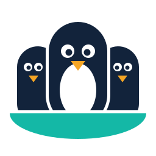
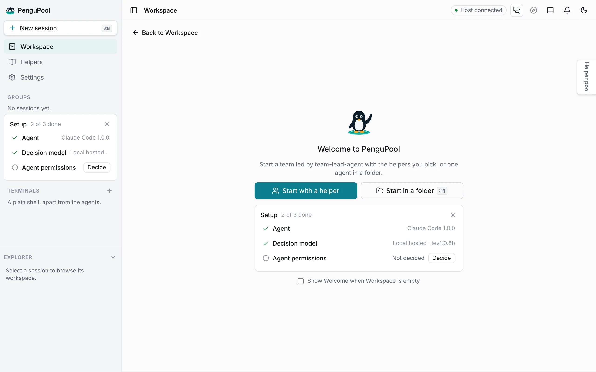

<p align="center"></p>

<p align="center">PenguPool brings your coding-agent team, your preferences and its waiting questions into one workspace. Run the agents you already use on your Mac as a team, say how you work once, and answer what waits on you from the Mac or your phone.</p>

<p align="center">
  <a href="https://github.com/nduwork/pengupool-ai/releases/latest">Download</a> ·
  <a href="docs/getting-started.md">Get started</a> ·
  <a href="docs/guide.md">Guide</a> ·
  <a href="docs/phone.md">Phone access</a> ·
  <a href="docs/design.md">Design</a>
</p>

## At a glance

**What it is.** A macOS desktop app with a Go host. The host runs coding agents (Claude Code, Codex, pi,
OMP), each in its own terminal session that outlives the app, and groups them into teams: a lead,
builders that own a repository, and helpers from the Helper hub. Every agent gets the owner's
recorded preferences (the Compass) in its context. Questions that need the owner are collected in one
place and can be answered on the Mac or from the paired Muse app.

**Run it.** macOS on Apple Silicon. Download `PenguPool-AI-<version>-mac-arm64.dmg` from the
[latest release](https://github.com/nduwork/pengupool-ai/releases/latest), drag the app onto
Applications and open it. Details are in [Install](#install); building from source is in
[CONTRIBUTING.md](CONTRIBUTING.md#build-from-source).

**Architecture.**

```
 Electron app (desktop/) / browser (web/)  ─┐
 CLI (cmd/pengupool) ── unix socket ────────┼─ gateway: loopback HTTP + WebSocket, Muse device API
 Muse app ── Tailscale Serve ───────────────┘        │
                                      pool: teams, sessions, helpers, Compass, triage
                                ┌────────────┬───────┴──────┬──────────────────┐
                               hub        store (JSON)   agentdb (SQLite)   decision (System One)
                                │
                     one PTY worker per session ── agents launched with PenguPool hooks
```

Package by package: [How it fits together](CONTRIBUTING.md#how-it-fits-together).

## How it works

**On your Mac, every agent works with your team's context.** PenguPool's hooks connect each agent's
session start, prompts and turn events to the team's context, your Compass and a helper's own journal,
so the agents work within the preferences you have already recorded.

**On your phone, the question comes back to you.** Pair the Muse app and it can read the team's
waiting requests, send your instructions and answer supported questions and check-ins. PenguPool
returns your answer to the session that asked through its existing owner-input and answer paths.
Pairing is optional.

Coding uses each agent's own model. Triage uses one System One decision model you choose (the local
Tev1 default is Together AI's Qwen-based model, or Jev online). It checks each task a lead or builder
hands a member and picks who does it; the sender can keep its own pick with a recorded reason.
[Model responsibilities](docs/harnesses.md#who-does-what).

## What you can do

- **Run agents side by side.** Claude Code, Codex, pi and OMP, plus Claude Code through
  Ollama, each in its own terminal session. Sessions keep running when the app or its host restarts.
- **Start a team.** Welcome's *Start with a helper* starts a team led by team-lead-agent with the
  helpers you pick (research, PR review, security, …), or start one agent in a folder and grow a team
  around it on the map: drop a session under it as a **Builder**, or a helper from the Helper pool.
- **Say it once.** Tell any session how you want things ("small commits", "never touch the migrations
  folder"). It becomes a line in your **Compass**, and every agent gets your Compass in its context.
  Each helper also keeps a private **journal** of the jobs it finished and starts its next job with them.
- **Answer what waits on you.** Questions, check-ins and permission prompts collect in *Waiting on you*,
  with enough context to decide; the map marks that session **? Need input**. With the Muse app paired,
  you answer team questions and check-ins from your phone; permission prompts are answered in the
  agent's terminal.

## Install

1. Download `PenguPool-AI-<version>-mac-arm64.dmg` from the
   [latest release](https://github.com/nduwork/pengupool-ai/releases/latest). It runs on macOS on
   Apple Silicon.
2. Open the disk image, drag **PenguPool AI.app** onto Applications, and open it. The app is notarized
   by Apple, so macOS opens it after its usual confirmation for downloaded apps, with no
   unidentified-developer warning.
3. Install and sign in to at least one coding agent: Claude Code, Codex, pi or OMP. PenguPool uses
   agents already installed on your Mac; this walkthrough uses Claude Code.

The app starts its host in the background and keeps its data in `~/.pengupool-ai/v2`. To build from
source instead, see [CONTRIBUTING.md](CONTRIBUTING.md).

## Your first session

<picture>
  <source media="(prefers-color-scheme: dark)" srcset="assets/screenshots/screen-welcome-dark.webp">
  
</picture>

1. **Open the app.** The empty Workspace shows the map, with a short Setup card in the sidebar.
   **Welcome** (above) is off by default: open it from the empty map's *show Welcome* link or
   Settings → General → **Open Welcome**.
2. **Set a decision model.** PenguPool needs a triage model: System One, local (Ollama) or online.
   In Settings → Decision model: pick it, **Save provider**, **Check connection**, then **Use for triage**.
3. **Decide agent permissions.** Settings → Agents → Agent permissions lets agents run PenguPool's
   team commands without a prompt, or keep asking. Either choice is fine.
4. **Start with Claude Code.** Choose *Start in a folder*, select a small demo repository and pick
   Claude Code. Ask it to inspect the project and propose one small improvement, with a clear question
   for you before changing it. (For a team, *Start with a helper* and pick the agent in the agent picker.)
5. **Try the phone loop (optional).** Follow [Phone access](docs/phone.md), open the team's supported
   pending question in the Muse app, and reply. The session gets your answer from its waiting ask, or
   as a notice if it had stopped waiting ([details](docs/phone.md#try-it)). You can keep using
   PenguPool from the Mac without pairing a phone; what needs you also appears in *Waiting on you*
   (the bell) and as a notification.

Step by step: [docs/getting-started.md](docs/getting-started.md).

## Help

| I want to… | Read |
| --- | --- |
| Install, set up and start my first session | [Getting started](docs/getting-started.md) |
| Work with sessions, teams, the Compass and journals | [Guide](docs/guide.md) |
| Know which agents work and what PenguPool sets up for them | [Agents (harnesses)](docs/harnesses.md) |
| Answer from my phone with the Muse app | [Phone access](docs/phone.md) |
| Fix something that isn't working | [Troubleshooting](docs/troubleshooting.md) |
| Use the command line | [CLI](docs/cli.md) |

## Contribute or report a problem

Report a bug or ask for a feature in [Issues](https://github.com/nduwork/pengupool-ai/issues). To build,
test or change PenguPool, read [CONTRIBUTING.md](CONTRIBUTING.md). Each release's changes are in
[CHANGELOG.md](CHANGELOG.md).

## License

[MIT](LICENSE).
