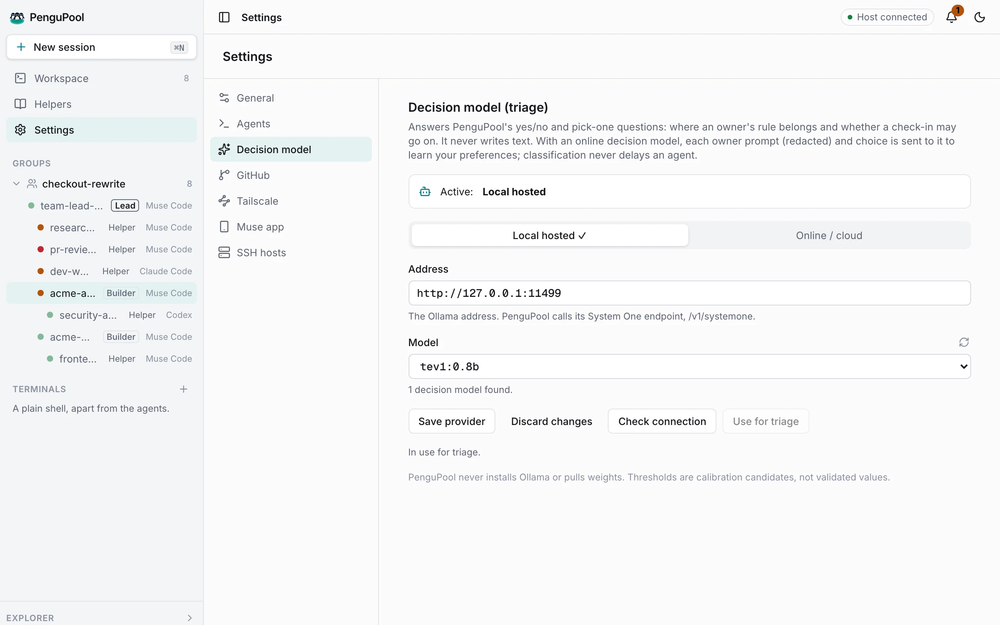
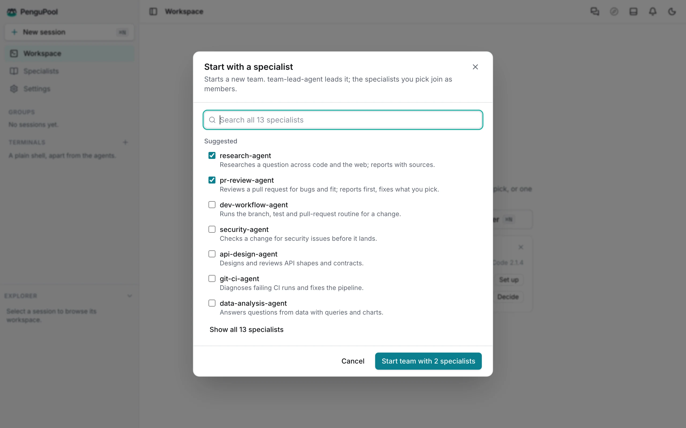

# Getting started

## What you need

- A Mac with Apple Silicon.
- At least one coding agent installed and signed in on its own. This walkthrough uses **Muse Code**,
  Meta's coding agent; PenguPool also supports Claude Code, Codex, pi and OMP. It runs the agents it
  finds on your login `PATH`; it never installs or signs in to them.
- A decision model for triage, either local through [Ollama](https://ollama.com) or online. PenguPool
  uses it to decide where your preferences belong and whether a check-in can go on. It is required.

## Install or update

1. Download `PenguPool-AI-<version>-mac-arm64.dmg` from the
   [latest release](https://github.com/nduwork/pengupool-ai/releases/latest).
2. Open it and drag **PenguPool AI.app** onto Applications, replacing an older copy.
3. Open the app. It starts its host in the background. Your sessions, settings and record live in
   `~/.pengupool-ai/v2` (set `PENGUPOOL_HOME` to move it) and are kept across updates.

When a newer release is out, the app shows an update pill in its title bar.

## First launch: Welcome

An empty Workspace shows **Welcome**: two ways to start, and a **Setup** card with three rows. Each
row opens the setting that fixes it.

| Setup row | Done when |
| --- | --- |
| Agent | at least one supported agent is installed |
| Decision model | a model is in use for triage (it passed its check) |
| Agent permissions | you chose either way |

You can hide Welcome with *Show Welcome when Workspace is empty*. Reopen it from Settings → General or
from the empty map.

## Set the decision model

<picture>
  <source media="(prefers-color-scheme: dark)" srcset="../assets/screenshots/screen-settings-dark.webp">
  
</picture>

Settings → **Decision model**:

1. Pick **Local hosted** (a System One decision model served by Ollama) or **Online / cloud**.
2. Fill in the address and model (and the API key for an online model), then **Save provider**.
3. **Check connection.** PenguPool asks the model a yes/no, a pick-one and a score question with
   plain answers, and shows how it did.
4. When the check passes, **Use for triage**.

The status line under the buttons always says where the saved settings stand. Saving again means
checking again. Until a model is in use, a banner says so and memory work waits.

## Decide agent permissions

Agents in a team message each other and search past work with PenguPool's command-line tool, and
each call can stop on the agent's own permission prompt. Settings → Agents → **Agent permissions** lets
Claude Code and Codex run PenguPool's team commands without asking: `send`, `search`, `experience
search`, `experience show`, `ask`, `answer`, `decide`, `team request add` and `team request remove`.
Nothing else is included; PenguPool still checks every call. Turning it off removes exactly what PenguPool wrote.
Details: [Agents (harnesses)](harnesses.md#agent-permissions).

## Start your first session

<picture>
  <source media="(prefers-color-scheme: dark)" srcset="../assets/screenshots/screen-start-dark.webp">
  
</picture>

- **Start with a specialist.** Starts a new team led by team-lead-agent. Tick the specialists you want
  (seven common ones are suggested; search reaches the rest), choose the work folder they will use,
  select **Muse Code** in the agent picker (or another installed agent), and **Start team**. The lead alone needs no folder. team-lead-agent and the other
  specialists come from the Specialist hub (the *Specialists* page).
- **Start in a folder** (⌘N, also *New session* in the sidebar). One agent in a folder, a new worktree
  of a repository, or a fresh clone. To start with Meta's coding agent, pick **Muse Code** as the agent.

### A first task with Muse Code

Choose **Start in a folder**, select a small demo repository and pick **Muse Code**. Ask it to inspect
the project and propose one small improvement, with a clear question for you before changing it.

When it needs you (a question, a permission prompt, or a check-in at the end of a turn) it appears
under the bell as **Waiting on you**, and as a notification. Answer the question there, or pair the
Muse app and answer it from your phone: see [Phone access → Try it](phone.md#try-it). Permission prompts
are answered in the agent's terminal.

Next: the [Guide](guide.md).
