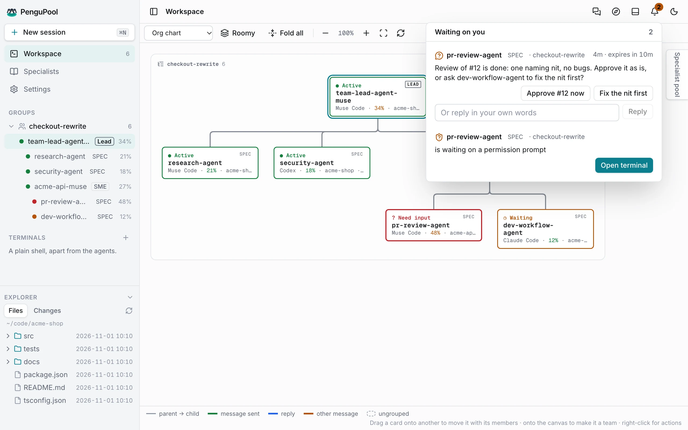

# Guide

Running several coding agents usually means repeating the same instructions in every session, losing
track of which one needs you, and re-explaining a project to an agent that did similar work last week.
PenguPool keeps your preferences in one Compass that every session reads, gives helpers a memory of
their finished jobs, and collects everything waiting on you in one place.

## Sessions

A session is one agent (or a plain terminal) running in its own terminal. Sessions run in workers
of their own, so they keep running when the app or its host restarts; the app reattaches to them.
An agent session that ended can be resumed from its own transcript.

## Teams and roles

A team is a tree of sessions. Each member's role comes from its place in the tree; nobody stores or
chooses it.

| Role | Who |
| --- | --- |
| **Lead** | The root of the tree. It combines the team's results and reports to you. It is a hub, not a boss: it cannot approve, merge or change the team's direction for you. |
| **Builder** | A member you added that works in a repository, usually in its own Git worktree under PenguPool's data folder. |
| **Helper** | A skill-backed agent from the Helper hub. It works outside the team's repositories and keeps its own journal across teams. |

Build a team by starting with a helper from Welcome, by dragging sessions onto each other on the
map, or by dragging a helper from the Helper pool onto a session. Helpers you add from Welcome or a
team request join under the Lead; to build a deeper tree (a builder with its own helpers, say), drag a
member onto another member on the map, and it moves there with everything under it. Members talk with
`pengupool send`, only to their parent and children on the tree; every message is recorded on the
team's message log.

## The Compass

Your Compass is your preferences and restrictions, learned from your own words. When you tell any
session, or the Muse app, how you want things, PenguPool has that session word it as one general line,
merging it with a line that already says it. Edit, merge or delete lines in the Compass panel.

- Only your words become lines; an agent's words never do.
- Every session gets your Compass in its context, as data, at start and whenever it changes.
- A line is guidance. It never overrides an approval or answers a question for you.

## Helpers' journals

When a helper reports `Done: <title>` to its parent, that report becomes an entry in its journal,
unless your triage model is sure it is trivial or a duplicate of a recent entry; each decision is on
the helper's session log.
The next time the helper works, it starts with the index of its past jobs and the entries that
match the task, and reads one in full with `pengupool experience show`. Each journal is private to its
helper. You can list, open and delete entries on the Helpers page.

## Waiting on you

<picture>
  <source media="(prefers-color-scheme: dark)" srcset="../assets/screenshots/screen-ask-dark.webp">
  
</picture>

Questions, check-ins and permission prompts collect under the bell. Each shows who asks, their team,
the question with its options, and the agent's last words, so you can decide from there. Questions and
check-ins are answered right there; a permission prompt is answered in the agent's own terminal. A decision
model answers some check-ins for you from your recorded decisions; anything on the floor (pushes,
merges, deletions, releases and similar) still comes to you.

## Restart and quit

Quitting the app leaves the host and its sessions running. Settings → General → **Restart host**
restarts the host; every session keeps running.
